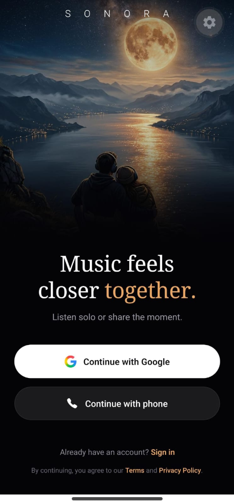
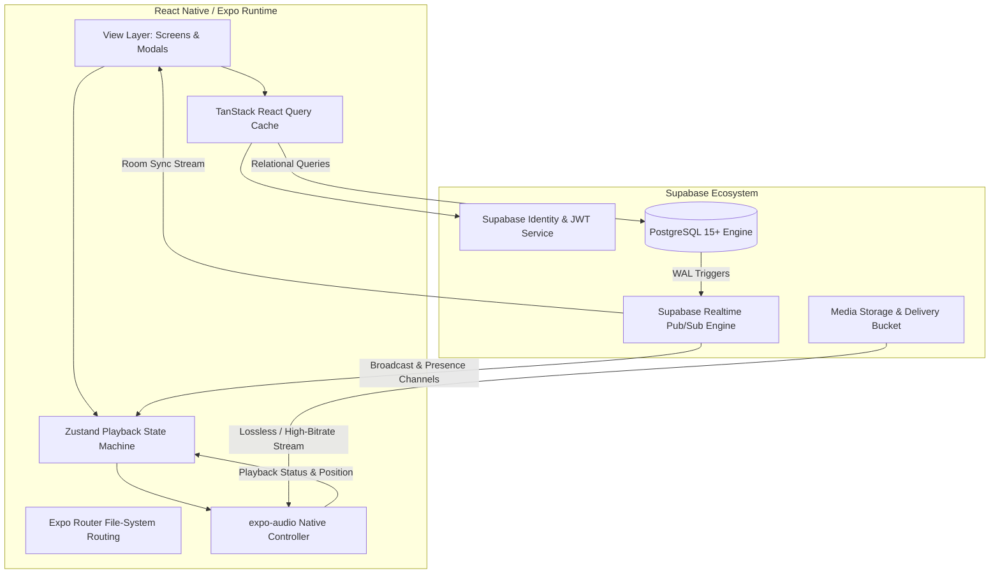

# Sonora

> Real-Time Shared Presence Audio Streaming Platform

<div align="left">
  
  
  
  
  
  
  
  
  
  
</div>

---

## Interface Overview

<p align="center">
  <br/>
  <em>Figure 1: Sonora Onboarding & Unified Authentication Gateway</em>
</p>


---

## Executive Summary & Product Vision

Mainstream consumer streaming services isolate listeners inside individual playback sandboxes. When users wish to share listening experiences in real time, they typically depend on fragmented voice calls or external screen-mirroring software, both of which suffer from high latency, severe audio downsampling, and desynchronized track progression.

**Sonora** re-architects mobile music playback around **shared presence**. Designed as a high-fidelity streaming ecosystem, Sonora couples a local zero-latency audio engine with real-time websocket synchronization to enable users to experience audio simultaneously, regardless of physical separation.

### Core Objectives

- **Distributed Synchronized Playback**: Maintain tight temporal alignment between listeners across heterogeneous networks.
- **Native-Grade Audio Execution**: Run audio processing through low-overhead native platform primitives with complete background execution.
- **Resilient Data Topology**: Leverage PostgreSQL Row-Level Security (RLS) and real-time pub/sub channels for scalable state propagation.
- **Refined Interaction Design**: Implement a coherent dark-luxe design system engineered around low cognitive load during active listening sessions.

---

## Architectural Breakdown & System Design



---

## Technical Specifications & Stack Justification

| Domain | Technology | Justification & Architectural Role |
|---|---|---|
| **Core Framework** | React Native `0.88.1` / React `19.3.0` | Enables high-throughput, cross-platform UI rendering with direct native bridge access. |
| **Tooling & Platform** | Expo SDK `58.0.22` | Continuous Native Generation (CNG) pipeline eliminating fragile manual Xcode/Gradle configuration. |
| **Navigation** | Expo Router `58.0.29` | File-system-based routing with full type safety (`typedRoutes`), deep linking, and nested stack/tab navigators. |
| **Audio Processing** | `expo-audio` `58.0.11` | Modern unified playback engine replacing legacy audio modules. Native audio session lifecycle, remote controls, and background service execution. |
| **Persistence & Auth** | Supabase `@supabase/supabase-js` `2.118` | Managed PostgreSQL database, row-level access control, and identity management with local AsyncStorage token persistence. |
| **Server State** | TanStack Query `v5.105.0` | Cache invalidation, window-focus refetching, query deduplication, and optimistic database updates. |
| **Client State** | Zustand `v5.0.16` | Lightweight state machine managing the active track queue, volume attenuation, repeat modes, and room listeners without re-render thrashing. |
| **Input Validation** | Zod `v4.6.7` & React Hook Form | Runtime schema validation and boundary guarantees for user authentication and profile mutations. |

---

## Engineering Use Cases & Implementation Architecture

### 1. Collaborative Listening Rooms (Distributed Real-Time Sync)

- **Mechanics**: Each session designates a session host. Playback events (play, pause, seek, track transition) trigger atomic database updates containing a monotonic `sequence_number` and anchor timestamp `updated_at`.
- **Drift Compensation**: Subscribed clients calculate delta drift upon receiving updates via WebSocket:
  $$\Delta t = t_{\text{local}} - t_{\text{updated\_at}}$$
  $$\text{Adjusted Position} = \text{position\_ms} + \Delta t$$
- If the difference between the local player head and the adjusted target exceeds $250\text{ ms}$, the client initiates a micro-seek to synchronize playback without audible stuttering.
- **Presence Tracking**: Member ingress and egress are tracked using Supabase presence heartbeats, keeping the active participant list synchronized.

### 2. Native Background Playback & Interruption Management

- **Operating System Integration**:
  - iOS: Background audio modes configured via `UIBackgroundModes: ["audio", "background"]`.
  - Android: Audio focus controls utilizing `android.permission.RECORD_AUDIO` and `android.permission.MODIFY_AUDIO_SETTINGS`.
- **Focus Transitions**: Transient audio interruptions (e.g., GPS turn-by-turn prompts) duck volume proportionally, while permanent interruptions (e.g., incoming cellular phone calls) pause playback and record the exact playback cursor for resumption upon call completion.

### 3. Multi-Modal Identity Infrastructure

- **Authentication Matrix**:
  - Google Identity Federation
  - Native SMS Phone OTP verification
  - LinkedIn OAuth integration
  - Traditional Email & Password with cryptographic credential validation
- **Persistence Layer**: Handled through asynchronous secure storage, validating session expiration silently and refreshing JWTs prior to critical API queries.

### 4. Cache Tiering & Offline Robustness

- Server-state queries (tracks, playlists, artist relations) are indexed and stored via TanStack Query.
- Network disconnections default to cached metadata alongside offline fallback modes, ensuring playback navigation remains responsive under adverse conditions.

---

## Relational Data Architecture

```plaintext
profiles (id, display_name, avatar_url, created_at)
   │
   ├──< playlists (id, owner_id, title, is_public, created_at)
   │       └──< playlist_tracks (playlist_id, track_id, position)
   │
   ├──< favorites (user_id, track_id, created_at)
   ├──< play_history (id, user_id, track_id, played_at, position_ms)
   │
   └──< rooms (id, leader_id, track_id, status, position_ms, sequence_number, updated_at)
           └──< room_members (room_id, user_id, joined_at, last_seen_at)

artists (id, name)
   │
   └──< albums (id, title, artist_id, artwork_path)
           └──< tracks (id, title, artist_id, album_id, duration_ms, audio_path)
```

### Table Definitions

| Table | Identifier | Foreign Relationships | Security & Access Pattern |
|---|---|---|---|
| `profiles` | UUID (PK) | References `auth.users` | Read: Public; Write: Profile Owner |
| `artists` | UUID (PK) | Independent entity | Read: Public; Write: System / Admin |
| `albums` | UUID (PK) | `artist_id -> artists.id` | Read: Public; Write: System / Admin |
| `tracks` | UUID (PK) | `artist_id -> artists.id`, `album_id -> albums.id` | Read: Public; Write: System / Admin |
| `playlists` | UUID (PK) | `owner_id -> profiles.id` | Read: Public if `is_public` else Owner; Write: Owner |
| `playlist_tracks`| Composite | `playlist_id -> playlists.id`, `track_id -> tracks.id` | Governed by parent playlist RLS policy |
| `favorites` | Composite | `user_id -> profiles.id`, `track_id -> tracks.id` | Read & Write restricted to authenticated user |
| `play_history` | UUID (PK) | `user_id -> profiles.id`, `track_id -> tracks.id` | Read & Write restricted to authenticated user |
| `rooms` | UUID (PK) | `leader_id -> profiles.id`, `track_id -> tracks.id` | Read: Public; Write: Session Leader |
| `room_members` | Composite | `room_id -> rooms.id`, `user_id -> profiles.id` | Read: Public; Write: Self or Room Leader |

---

## Repository Structure

```plaintext
SONORA/
├── app/
│   ├── (auth)/                  # Authentication routing group
│   │   ├── email-signup.tsx     # Email credentials registration
│   │   ├── linkedin-signup.tsx  # OAuth identification
│   │   ├── login.tsx            # Standard authentication form
│   │   ├── phone-signup.tsx     # SMS verification workflow
│   │   └── welcome.tsx          # Production onboarding gateway
│   ├── (tabs)/                  # Primary bottom tab navigator
│   │   ├── _layout.tsx          # Frosted surface navigation bar
│   │   ├── index.tsx            # Home feed (Rooms, recent plays, playlists)
│   │   ├── search.tsx           # Debounced multi-index search
│   │   ├── library.tsx          # Playlists, favorites, and collections
│   │   └── settings.tsx         # Playback quality, cache, and profile
│   ├── providers/               # Root state & configuration providers
│   │   ├── queryClient.ts       # TanStack Query configuration
│   │   ├── SupabaseProvider.tsx # Auth session lifecycle provider
│   │   └── ThemeProvider.tsx    # Design tokens and themes
│   ├── room/
│   │   └── [id].tsx             # Synchronized room playback screen
│   ├── _layout.tsx              # Root Stack navigation tree
│   ├── index.tsx                # Initial splash and route resolver
│   └── player.tsx               # Modal playback console and queue manager
├── assets/
│   ├── screenshots/             # Production UI documentation assets
│   │   └── login-screen.png     # Interface preview
│   └── welcome_bg.jpg           # Dynamic splash asset
├── lib/
│   ├── supabase.ts              # Client instance and fallback initialization
│   ├── types.ts                 # TypeScript domain entities and schemas
│   └── utils.ts                 # Time formatting and numerical utilities
├── scripts/
│   └── patch-expo.js            # Build compatibility patch for Expo core modules
├── app.json                     # Native application manifests and plugins
├── package.json                 # Dependency definitions and scripts
└── tsconfig.json                # TypeScript compilation configuration
```

---

## Local Development & Setup

### Environment Requirements
- **Node.js**: `20.x` LTS or greater
- **Package Manager**: `npm` or `bun`
- **Native SDKs**:
  - Android Studio with SDK Platform 34+
  - Xcode 16+ (macOS only, required for iOS simulator)

### Setup Instructions

```bash
# 1. Clone repository
git clone https://github.com/venkatesh-yadagiri/sonora.git
cd sonora

# 2. Install dependencies (runs patch-expo.js automatically via postinstall)
npm install

# 3. Configure local environment variables
cp .env.example .env
```

Populate the `.env` configuration:

```ini
EXPO_PUBLIC_SUPABASE_URL=https://your-project.supabase.co
EXPO_PUBLIC_SUPABASE_ANON_KEY=your-anon-key
```

### Execution Commands

```bash
# Start local Metro bundler
npx expo start

# Launch on iOS Simulator
npx expo start --ios

# Launch on Android Emulator
npx expo start --android

# Execute static type checking
npx tsc --noEmit
```

---

## Continuous Native Generation (CNG) & Release Engineering

The project follows Expo CNG principles: the native directories are generated dynamically from configuration plugins in `app.json`.

```bash
# Generate native source projects locally for inspection
npx expo prebuild

# Submit development build through Expo Application Services (EAS)
npx eas-cli@latest build --profile development --platform all

# Compile release builds
npx eas-cli@latest build --profile production --platform all
```

---

## License

This software is distributed under the MIT License. Refer to the [LICENSE](LICENSE) file for complete terms.
